# CS6650 Homework 5 — Product API

A simple Product API built from an OpenAPI spec, deployed to AWS ECS with Terraform, load-tested with Locust, and instrumented with Prometheus + Grafana.

## Where things live
- **Server code:** `src/product-service.go` (Go + Gin, implements the Product endpoints from `api.yaml`)
- **Dockerfile:** `src/Dockerfile` (multi-stage build, pinned to `linux/amd64` for Fargate)
- **Infrastructure (Terraform):** `terraform/` — `provider.tf`, `variables.tf`, `main.tf`, `outputs.tf`, and `modules/` (ecr, ecs, logging, network)
- **Load tests:** `locust/locustfile.py`
- **Observability:** `observability/docker-compose.yml` and `observability/prometheus.yml` (local Prometheus + Grafana)
- **Screenshots:** `screenshots/`
- **Report:** `HW5_report.pdf`

## The Product API
Two endpoints, implemented exactly per the Product section of `api.yaml`:
- `GET /products/{productId}` — retrieve a product by ID
- `POST /products/{productId}/details` — add/update a product's details

Products are stored in memory in a map, guarded by a read-write mutex so concurrent requests are safe.

## How to deploy on another machine

### Prerequisites
- AWS CLI, Terraform, and Docker Desktop installed
- AWS credentials configured for region us-west-2

### Steps
1. Configure credentials (from the Learner Lab):
   ```
   aws configure
   aws configure set aws_session_token <YOUR-TEMP-SESSION-TOKEN>
   aws configure set region us-west-2
   ```
2. Deploy:
   ```
   cd terraform
   terraform init
   terraform apply -auto-approve
   ```
3. Get the public IP of the running task (run from the `terraform/` folder):
   ```
   aws ec2 describe-network-interfaces \
     --network-interface-ids $(
       aws ecs describe-tasks \
         --cluster $(terraform output -raw ecs_cluster_name) \
         --tasks $(aws ecs list-tasks --cluster $(terraform output -raw ecs_cluster_name) \
           --service-name $(terraform output -raw ecs_service_name) --query 'taskArns[0]' --output text) \
         --query "tasks[0].attachments[0].details[?name=='networkInterfaceId'].value" --output text) \
     --query 'NetworkInterfaces[0].Association.PublicIp' --output text
   ```
4. Tear down when done:
   ```
   terraform destroy -auto-approve
   aws ecr delete-repository --repository-name ecr_service --region us-west-2 --force
   ```

The Terraform `apply` builds the image, pushes it to ECR, and creates the whole stack automatically:

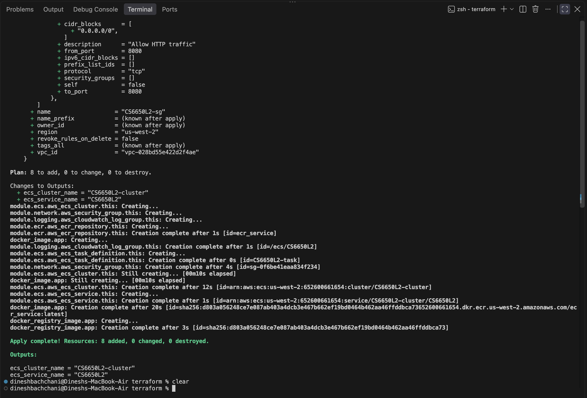

## Example requests (every response code)

Replace `HOST` with `localhost` (local) or the task's public IP (deployed).

**POST a valid product → 204 No Content**
```
curl -i -X POST http://HOST:8080/products/1/details \
  -H "Content-Type: application/json" \
  -d '{"product_id":1,"sku":"ABC-123-XYZ","manufacturer":"Acme Corporation","category_id":456,"weight":1250,"some_other_id":789}'
```

**GET an existing product → 200 OK**
```
curl -i http://HOST:8080/products/1
```

**GET a missing product → 404 Not Found**
```
curl -i http://HOST:8080/products/999
```

**POST invalid data (missing required fields) → 400 Bad Request**
```
curl -i -X POST http://HOST:8080/products/2/details \
  -H "Content-Type: application/json" -d '{"sku":""}'
```

**GET with a non-integer ID → 400 Bad Request**
```
curl -i http://HOST:8080/products/abc
```

All five response codes working against the deployed API (204, 200, 404, 400, 400):

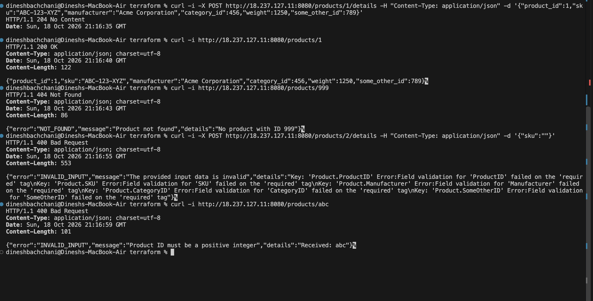

## Load testing (Part IV)
Run Locust against the deployed API:
```
cd locust
locust -f locustfile.py --host http://<PUBLIC-IP>:8080
```
Open http://localhost:8089 and start a test.

### Baseline: 50 users
~32 req/sec, 0 failures, median ~88ms. The server is comfortable at this load.

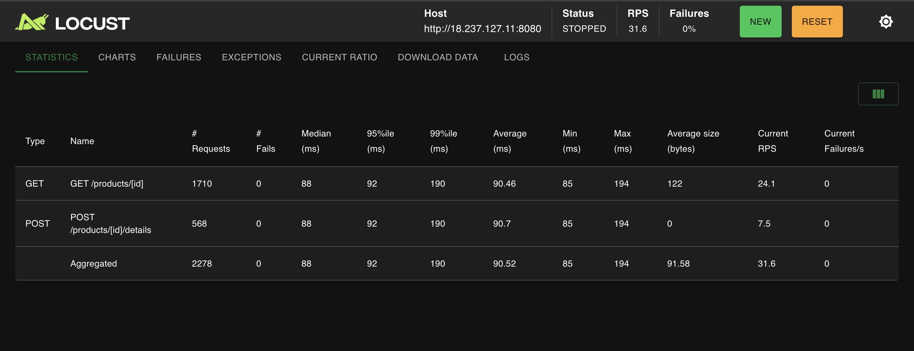
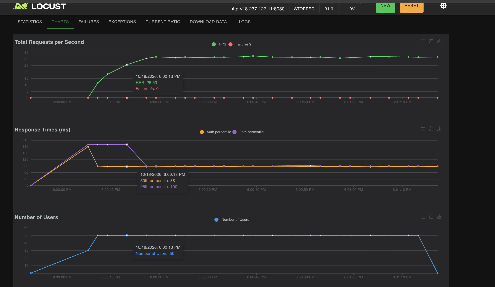

### Stress test: 2000 users
Throughput plateaued at ~1221 req/sec and could not go higher, 176 requests failed, and max latency spiked to ~23 seconds. This is where the server starts to struggle: the single Fargate task (0.25 vCPU) hits its throughput ceiling, so requests queue up (huge max latency) and some are dropped (failures). The fix would be to scale horizontally (more tasks behind a load balancer) or give the task more CPU/memory.

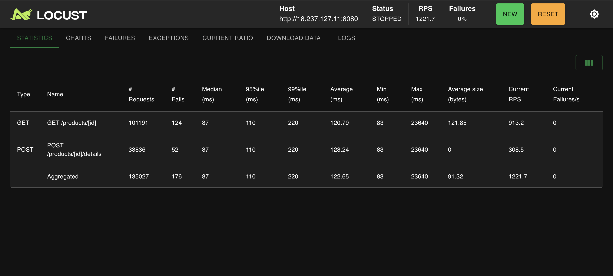
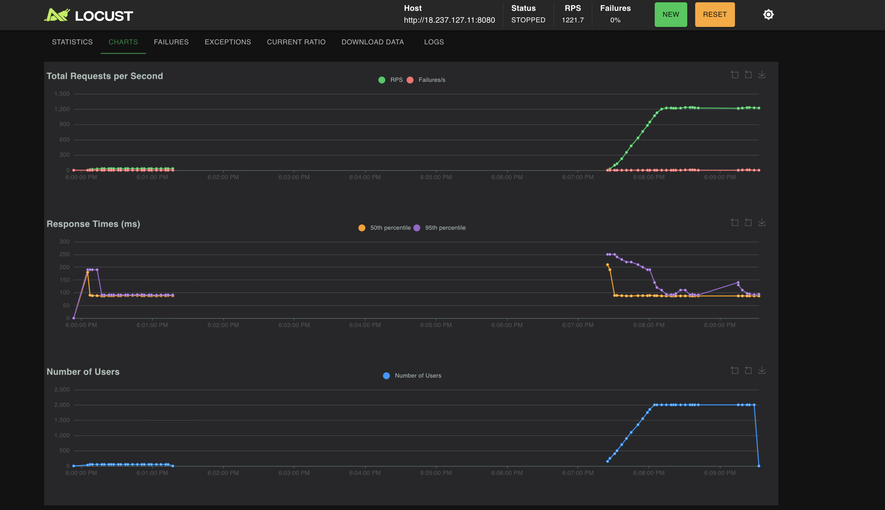

### HttpUser vs FastHttpUser
At 50 users the two are nearly identical (~32 req/sec, similar latency). At this modest load the client is not the bottleneck, so the faster C-based client has nothing to speed up; response times are dominated by the server and network. FastHttpUser only helps when the load generator itself is the limiting factor.

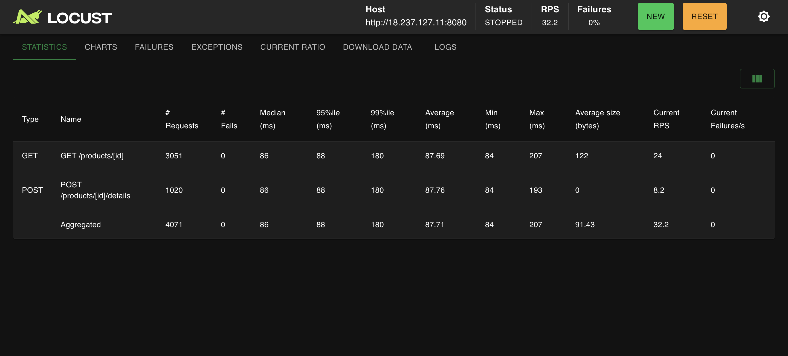
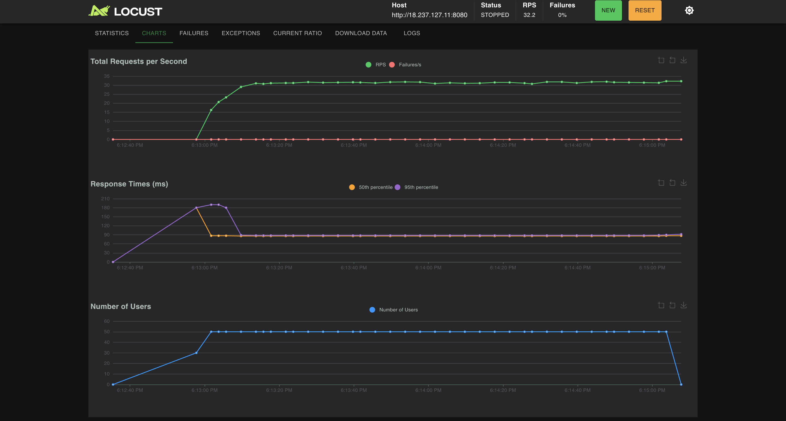

## Observability (Part V)
The server exposes `/metrics` (Prometheus) with the RED signals: request rate, error count, and a latency histogram. It also emits one structured JSON log line per request.

Run the local monitoring stack alongside the server:
```
cd observability
docker compose up -d
```
- Prometheus: http://localhost:9090
- Grafana: http://localhost:3000 (admin/admin), dashboard "Product API RED" with Rate, Errors, and Duration panels.

### Dashboard: idle vs loaded
With no real traffic the dashboard is flat and the Errors panel has no data:

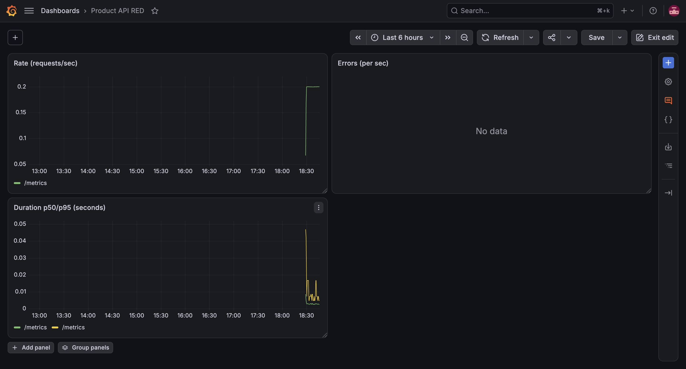

Under load, all three RED panels come alive. The Errors panel lit up because the GET load hit products that did not exist in the fresh local instance, so the server correctly returned 404s — a good demonstration that the observability setup surfaces error conditions in real time:

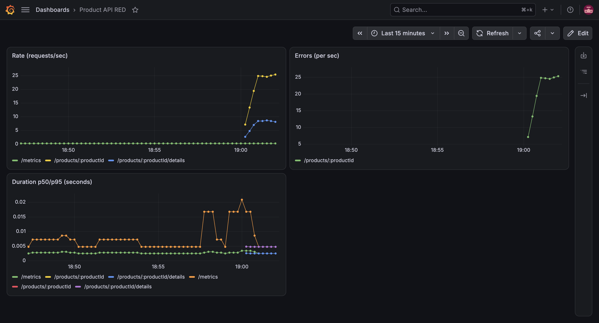

The Locust run that drove the dashboard (the failures are those 404s):

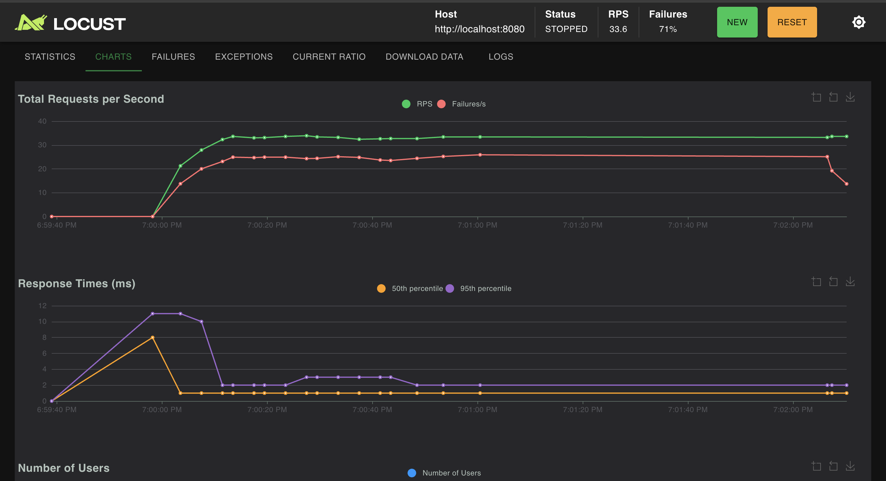

### Log excerpt (same run)
```
{"duration_ms":0,"method":"POST","path":"/products/:productId/details","status":204,"time":"2026-10-18T19:02:08-04:00"}
{"duration_ms":0,"method":"GET","path":"/products/:productId","status":200,"time":"2026-10-18T19:02:08-04:00"}
{"duration_ms":0,"method":"GET","path":"/products/:productId","status":200,"time":"2026-10-18T19:02:08-04:00"}
{"duration_ms":1,"method":"GET","path":"/metrics","status":200,"time":"2026-10-18T19:02:12-04:00"}
{"duration_ms":2,"method":"GET","path":"/metrics","status":200,"time":"2026-10-18T19:02:27-04:00"}
```

### When to use the dashboard vs the logs
I would look at the Grafana dashboard for a live, at-a-glance view during load, to spot trends like rising error rates or latency in real time. I would look at the logs after the fact to debug a specific request, since each log line has the exact endpoint, status, and duration that the aggregated dashboard cannot show.
